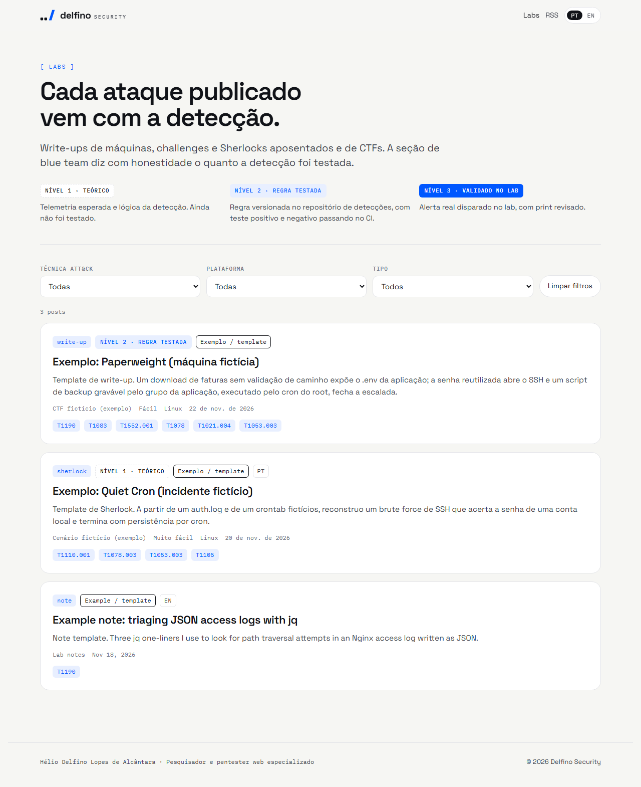

# Delfino Security — Landing page and Labs

Author: Hélio Delfino Lopes de Alcântara — Security researcher & web penetration tester.

Português: [README-pt-BR.md](README-pt-BR.md)

The repository holds two things:

1. **The landing page** (plain HTML + CSS + JS, no build step) presenting Delfino Security's three services:
   codebase vulnerability analysis, automated Web + AI pentest and secure development consulting.
2. **`/labs`**, the write-ups section: retired Hack The Box content (machines, challenges, Sherlocks) and CTFs,
   each with the attack and a "how the blue team would catch it" box that declares its evidence level.
   Built with Astro; the build copies the landing files unchanged.

## Landing files

| File | Contents |
|---|---|
| `index.html` | Structure and PT-BR copy (default language) |
| `styles.css` | Visuals: color/font tokens, responsive layout |
| `main.js` | Contact settings, EN translations, e-mail copy button and radar animation |
| `favicon.svg` | `../` icon on a dark tile |

### Before publishing

1. The WhatsApp number lives in `WHATSAPP_NUMBER` in `main.js` (country + area code, digits only).
2. Review the copy that makes promises ("0 false positives").
3. To edit copy: change the PT-BR text in `index.html` and the matching EN string in the `EN` object in
   `main.js` (same `data-i18n` key).

## Labs (`/labs`)



| Screenshot | Width |
|---|---|
| [Index](docs/screenshots/labs-index-1280.png) · [Example post](docs/screenshots/labs-post-1280.png) | 1280 px |
| [Index](docs/screenshots/labs-index-400.png) · [Example post](docs/screenshots/labs-post-400.png) | 400 px |

What a post has:

- Header: platform, difficulty, OS, retirement date (HTB) or event date (CTF), ATT&CK techniques.
- Summary, attack timeline, walkthrough in Markdown with a copy button on every code block.
- Optional detection box with an explicit **evidence level**, shown as a text badge:

| Level | Badge | Meaning |
|---|---|---|
| 1 | `LEVEL 1 · THEORETICAL` | Expected telemetry and detection logic, not tested |
| 2 | `LEVEL 2 · RULE TESTED` | Links to a rule in the detections repo whose positive and negative tests pass in CI |
| 3 | `LEVEL 3 · VALIDATED IN LAB` | Real alert screenshot from the lab |

Content types: `writeup`, `sherlock`, `note`. The index filters by ATT&CK technique (a parent such as `T1053`
also matches `T1053.003`), platform and type; filters are kept in the URL (`/labs/?type=sherlock`).
Feed: `/labs/rss.xml`.

The first real write-up is **Cap** (a retired easy HTB machine), in PT and EN. How to write a post, the HTB
publishing rules and the screenshot checklist: [docs/labs-authoring-en.md](docs/labs-authoring-en.md).

Two more real write-ups are **parked** in [`labs-pending/`](labs-pending/README.md) — Abducted and Bedside —
because each needs its box's retirement date, to be confirmed in the HTB account. The build refuses HTB content
without a valid retirement date, so they only go in after that check.

### Layout

| Path | Contents |
|---|---|
| `astro.config.mjs` | Astro config and the `landing-passthrough` integration that copies the landing files into `dist/` |
| `src/content.config.ts` | Post schema (Zod) and the publishing rules enforced at build time |
| `src/content/labs/<slug>/<lang>.md` | Posts; `<lang>` is `pt-BR` or `en`, same folder = translations of each other |
| `src/data/rules-index.json` | Pinned detection rules index (currently a **sample**) |
| `schemas/rules-index.schema.json` | JSON Schema the detections repo must follow when publishing the index |
| `src/lib/` | Taxonomy, i18n strings, post helpers, rules index loader |
| `src/components/`, `src/layouts/`, `src/pages/labs/` | UI and routes |
| `src/styles/tokens.css` + `fonts/` | Copied unchanged from Delfino UI |
| `scripts/verifyBuild.mjs` | Post-build check: landing hashes, RSS well-formed, every feed item has a page |

### Commands

Node **22.23.4 or newer** is required (Astro 7 refuses to start on older versions).

```bash
npm ci
npm run build     # outputs dist/: landing at /, labs at /labs/
npm run verify    # landing byte-identical, rss.xml well-formed
npm run check     # TypeScript + Astro diagnostics
npm run preview   # serves dist/ at http://localhost:4321
```

`npm run dev` serves only `/labs/` with hot reload; the landing is not served in dev, use `build` + `preview`
to see both. Set `SITE_URL` (for example `SITE_URL=https://your-domain npm run build`) so canonical links and
the RSS feed use the real domain; without it they use the placeholder `https://example.invalid`.

### Pinning the rules index

Level 2 links never read the detections repo directly. They resolve through `src/data/rules-index.json`, a
file published as a release asset of that repo and copied here with a fixed version:

1. Download `rules-index.json` from a specific release (never `latest`).
2. Replace `src/data/rules-index.json`, keep `"sample": false`.
3. `npm run build`: it fails if the file does not match the schema or if a post points to a rule missing from it.
4. Commit as `chore(labs): pin rules index to vX.Y.Z`.

## Why this architecture

| Decision | Choice | Rejected alternatives | Reason |
|---|---|---|---|
| Where | `/labs` inside this site | new site or subdomain | the plan asks for it; the site already has traffic and identity |
| Generator | **Astro** with typed Content Collections | hand-written HTML; Hugo; Next.js; Eleventy | Markdown posts with a validated frontmatter is what keeps posts honest (retired date, evidence level, rule ids). Astro does that natively with Zod and outputs plain static files. Hugo has no typed schema; Next is an app framework with a runtime we don't need; Eleventy would need the validation written by hand |
| Landing | **left at the repo root, untouched**, copied into `dist/` after the build | migrating the landing into Astro (`src/pages/index.astro` or `public/`) | any migration rewrites or moves the files that are live today. Leaving them in place means the current deploy keeps working even before the build is wired, and `npm run verify` proves `dist/` serves the same bytes |
| Copy step | small integration in `astro.config.mjs` (`astro:build:done`) | a separate shell/npm post-build script; symlinks | runs on every `astro build`, works on Windows and on any CI, no extra tool |
| Post format | Markdown + structured frontmatter (timeline, detection) | MDX with a `<Detection>` component inside the text | frontmatter is validated by the schema, so "level 2 without a rule" or "level 3 without a screenshot" fails the build. MDX would add a dependency and let the box be written without validation |
| Evidence levels | 3 declared levels, text badges | a generic "blue team" section | never overstates what was tested; no emoji, per the design base |
| Rules integration | pinned `rules-index.json` + JSON Schema | reading the detections repo at build time; git submodule | links don't break when the other repo changes, and neither repo blocks the other |
| Publishing rules | enforced in the build | checklist only | HTB without retirement date, future retirement date, Pro Labs, flag patterns and unknown rules stop the build |
| Bilingual | one file per language, URL `/labs/pt/…` and `/labs/en/…`; the index reuses the landing's `ds-lang` preference and toggle | one page that swaps the whole text with JS (as the landing does) | posts are long and may exist in only one language; separate pages are indexable and linkable. The index chrome still switches client-side like the landing |
| Styling | Delfino UI `tokens.css` + fonts copied verbatim, own `labs.css` | importing the landing `styles.css`; Tailwind | the design base requires tokens unchanged; reusing the landing CSS would couple the two; Tailwind is one more dependency for a few pages |
| Code highlighting | Astro's built-in Shiki with the `css-variables` theme mapped to the `code-*` tokens | Prism; client-side highlighting | zero extra dependency, no client JS, colors come from the design tokens |
| Fonts | self-hosted from Delfino UI (bundled by Vite) | Google Fonts (what the landing uses) | no third-party request on the labs pages; the landing was left as is |

### Dependencies added

| Package | Version | Type | Why | Alternatives rejected |
|---|---|---|---|---|
| `astro` | 7.4.13 | runtime (build) | static generator, Content Collections with Zod, Shiki, image pipeline | Astro 6.4.8 (its `engines` field accepts the current Node 22.22), but `npm audit` reported critical/high advisories fixed only in 7.x (including the image pipeline and `sharp`) |
| `@astrojs/rss` | 4.0.19 | runtime (build) | official RSS generator, handles escaping and dates | writing the XML by hand |
| `@astrojs/check` | 0.9.12 | dev | `npm run check` type-checks `.astro` and `.ts` files | relying only on the build |
| `typescript` | 6.0.3 | dev | required by `@astrojs/check` (it accepts `^5 \|\| ^6`, not 7) | TypeScript 7 (not supported by `@astrojs/check` yet) |
| `fast-xml-parser` | 5.12.1 | dev | `npm run verify` checks that `rss.xml` is well-formed; already a dependency of `@astrojs/rss`, pinned explicitly so the script doesn't depend on a transitive package | an external validator service; a new XML library |

Engine: `package.json` declares `node >=22.23.4` and `.nvmrc` pins `22.23.5`. `npm audit` reported 0 vulnerabilities
after `npm audit fix` updated the transitive `esbuild` (Windows dev-server file read advisory).

## Run locally

Landing only: open `index.html` in a browser. Landing + labs: `npm run build && npm run preview`.

## Deploy

The landing can still be deployed exactly as before (no build). To publish `/labs`, the host must run
`npm ci && npm run build` with Node ≥ 22.23.4 and publish the **`dist/`** folder, with `SITE_URL` set to the
real domain.

- **Vercel:** framework preset "Astro" (or "Other"), build command `npm run build`, output directory `dist`.
- **Netlify:** build command `npm run build`, publish directory `dist`.
- **GitHub Pages:** a workflow that runs the build and uploads `dist/` (the "deploy from branch" mode serves the
  repo root and would not include `/labs`).

Then point your custom domain in the chosen service's settings.
