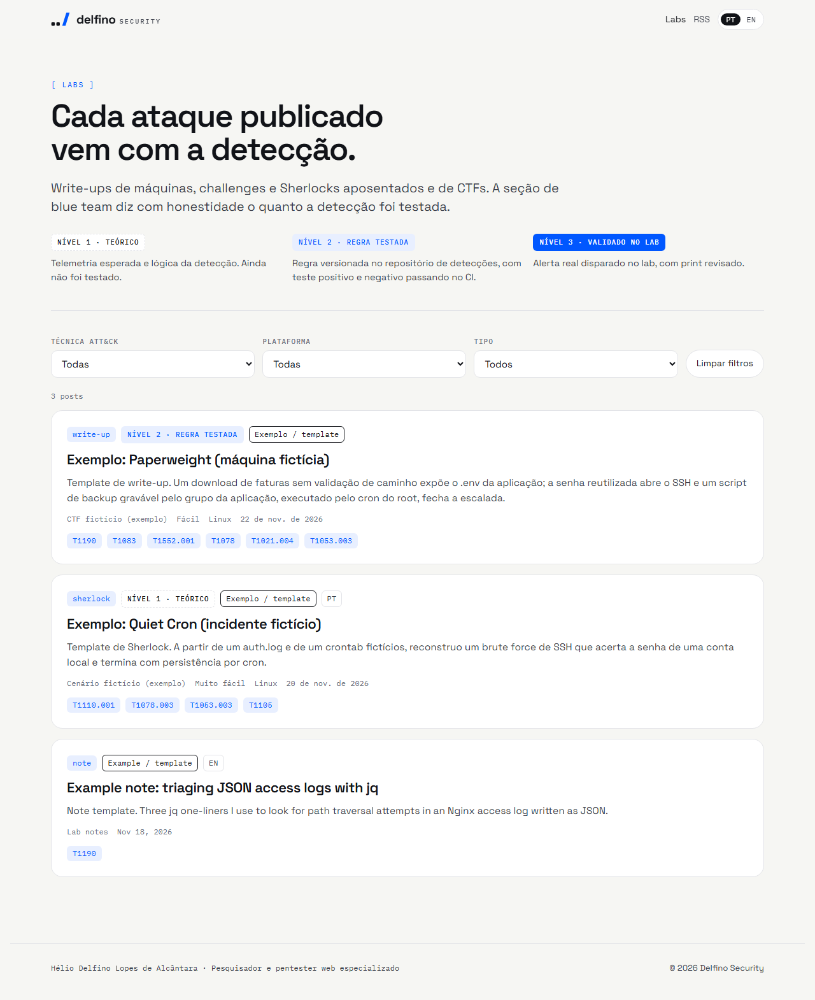

# Delfino Security — Landing page e Labs

Autor: Hélio Delfino Lopes de Alcântara — Pesquisador e pentester web especializado.

English: [README-en.md](README-en.md)

O repositório guarda duas coisas:

1. **A landing page** (HTML + CSS + JS puro, sem build) que apresenta os três serviços da Delfino Security:
   análise de vulnerabilidades em codebase, pentest automatizado Web + IA e consultoria de desenvolvimento seguro.
2. **`/labs`**, a seção de write-ups: conteúdo aposentado do Hack The Box (machines, challenges, Sherlocks) e CTFs,
   cada um com o ataque e com um box "como o blue team pegaria" que declara o nível de evidência.
   Feita com Astro; o build copia os arquivos da landing sem alterar nada.

## Arquivos da landing

| Arquivo | Conteúdo |
|---|---|
| `index.html` | Estrutura e textos em PT-BR (padrão) |
| `styles.css` | Visual: tokens de cor/fonte, layout responsivo |
| `main.js` | Configuração de contato, traduções EN, cópia do e-mail e animação do radar |
| `favicon.svg` | Ícone `../` sobre fundo escuro |

### Antes de publicar

1. O número do WhatsApp fica em `WHATSAPP_NUMBER`, no `main.js` (DDI + DDD, só dígitos).
2. Revise os textos que prometem algo ("0 falso positivo").
3. Para editar um texto: altere o PT-BR no `index.html` e o EN correspondente no objeto `EN` de `main.js`
   (mesma chave `data-i18n`).

## Labs (`/labs`)



| Print | Largura |
|---|---|
| [Índice](docs/screenshots/labs-index-1280.png) · [Post de exemplo](docs/screenshots/labs-post-1280.png) | 1280 px |
| [Índice](docs/screenshots/labs-index-400.png) · [Post de exemplo](docs/screenshots/labs-post-400.png) | 400 px |

O que um post tem:

- Cabeçalho: plataforma, dificuldade, SO, data de aposentadoria (HTB) ou do evento (CTF), técnicas ATT&CK.
- Resumo, linha do tempo do ataque, passo a passo em Markdown com botão de copiar em todo bloco de código.
- Box de detecção opcional, com **nível de evidência** explícito em selo de texto:

| Nível | Selo | Significado |
|---|---|---|
| 1 | `NÍVEL 1 · TEÓRICO` | Telemetria esperada e lógica da detecção, sem teste |
| 2 | `NÍVEL 2 · REGRA TESTADA` | Link para uma regra do repositório de detecções com teste positivo e negativo passando no CI |
| 3 | `NÍVEL 3 · VALIDADO NO LAB` | Print real do alerta no lab |

Tipos de conteúdo: `writeup`, `sherlock`, `note`. O índice filtra por técnica ATT&CK (uma técnica pai como
`T1053` também pega `T1053.003`), plataforma e tipo; os filtros ficam na URL (`/labs/?type=sherlock`).
Feed: `/labs/rss.xml`.

Write-ups reais publicados: **Cap** (easy, PT e EN), **Abducted** e **Bedside** (medium, PT). Todos de
máquinas aposentadas do HTB, com caixa de detecção em nível 1 (lógica teórica, ainda não validada em lab).
Como escrever um post, as regras de publicação do HTB e o checklist de print:
[docs/labs-authoring-pt-BR.md](docs/labs-authoring-pt-BR.md).

### Estrutura

| Caminho | Conteúdo |
|---|---|
| `astro.config.mjs` | Configuração do Astro e a integração `landing-passthrough`, que copia os arquivos da landing para `dist/` |
| `src/content.config.ts` | Schema dos posts (Zod) e as regras de publicação checadas no build |
| `src/content/labs/<slug>/<lang>.md` | Posts; `<lang>` é `pt-BR` ou `en`, mesma pasta = traduções um do outro |
| `src/data/rules-index.json` | Índice de regras de detecção fixado (hoje é um **exemplo**) |
| `schemas/rules-index.schema.json` | JSON Schema que o repositório de detecções precisa seguir ao publicar o índice |
| `src/lib/` | Taxonomia, textos PT/EN, funções de post, leitor do índice de regras |
| `src/components/`, `src/layouts/`, `src/pages/labs/` | Interface e rotas |
| `src/styles/tokens.css` + `fonts/` | Copiados sem alteração do Delfino UI |
| `scripts/verifyBuild.mjs` | Checagem pós-build: hash da landing, RSS bem formado, todo item do feed tem página |

### Comandos

Precisa de Node **22.23.4 ou mais novo** (o Astro 7 não inicia em versões anteriores).

```bash
npm ci
npm run build     # gera dist/: landing em /, labs em /labs/
npm run verify    # landing idêntica byte a byte, rss.xml bem formado
npm run check     # diagnóstico de TypeScript + Astro
npm run preview   # serve dist/ em http://localhost:4321
```

`npm run dev` serve só `/labs/` com hot reload; a landing não aparece no dev, use `build` + `preview` para ver as
duas. Defina `SITE_URL` (ex.: `SITE_URL=https://seu-dominio npm run build`) para os links canônicos e o RSS usarem
o domínio real; sem ele, usam o placeholder `https://example.invalid`.

### Fixando o índice de regras

Os links de nível 2 nunca leem o repositório de detecções direto. Eles passam por `src/data/rules-index.json`, um
arquivo publicado como asset de release daquele repositório e copiado para cá com versão fixa:

1. Baixe o `rules-index.json` de uma release específica (nunca `latest`).
2. Substitua `src/data/rules-index.json`, com `"sample": false`.
3. `npm run build`: falha se o arquivo não bater com o schema ou se algum post apontar para uma regra que não está nele.
4. Commit como `chore(labs): pin rules index to vX.Y.Z`.

## Por que essa arquitetura

| Decisão | Escolha | Alternativas descartadas | Motivo |
|---|---|---|---|
| Onde | `/labs` dentro deste site | site ou subdomínio novo | o plano pede; o site já tem tráfego e identidade |
| Gerador | **Astro** com Content Collections tipadas | HTML escrito à mão; Hugo; Next.js; Eleventy | posts em Markdown com frontmatter validado são o que mantém os posts honestos (data de aposentadoria, nível de evidência, id da regra). O Astro faz isso nativamente com Zod e gera arquivos estáticos puros. Hugo não tem schema tipado; Next é framework de aplicação, com runtime que não precisamos; no Eleventy a validação teria de ser escrita à mão |
| Landing | **fica na raiz do repo, intocada**, copiada para `dist/` depois do build | migrar a landing para o Astro (`src/pages/index.astro` ou `public/`) | qualquer migração reescreve ou move os arquivos que estão no ar. Deixando onde estão, o deploy atual continua funcionando mesmo antes de o build ser configurado, e o `npm run verify` prova que o `dist/` serve os mesmos bytes |
| Passo de cópia | integração pequena no `astro.config.mjs` (`astro:build:done`) | script de pós-build separado; symlink | roda em todo `astro build`, funciona no Windows e em qualquer CI, sem ferramenta extra |
| Formato do post | Markdown + frontmatter estruturado (linha do tempo, detecção) | MDX com componente `<Detection>` no meio do texto | o frontmatter é validado pelo schema, então "nível 2 sem regra" ou "nível 3 sem print" quebra o build. MDX traria uma dependência a mais e deixaria o box ser escrito sem validação |
| Níveis de evidência | 3 níveis declarados, selos de texto | seção genérica de "blue team" | nunca exagera o que foi testado; sem emoji, como pede a base de design |
| Integração com as regras | `rules-index.json` fixado + JSON Schema | ler o repositório de detecções no build; submódulo git | links não quebram quando o outro repo muda, e um repo não trava o outro |
| Regras de publicação | checadas no build | só checklist | HTB sem data de aposentadoria, aposentadoria no futuro, Pro Labs, padrões de flag e regra desconhecida param o build |
| Bilíngue | um arquivo por idioma, URL `/labs/pt/…` e `/labs/en/…`; o índice reaproveita a preferência `ds-lang` e o seletor da landing | uma página que troca o texto inteiro via JS (como a landing) | posts são longos e podem existir em um idioma só; páginas separadas são indexáveis e linkáveis. A interface do índice continua trocando no cliente como a landing |
| Estilo | `tokens.css` e fontes do Delfino UI copiados sem alteração, `labs.css` próprio | importar o `styles.css` da landing; Tailwind | a base de design exige os tokens sem alteração; reaproveitar o CSS da landing acoplaria as duas; Tailwind é mais uma dependência para poucas páginas |
| Destaque de código | Shiki embutido no Astro com tema `css-variables` ligado aos tokens `code-*` | Prism; destaque no cliente | nenhuma dependência extra, sem JS no cliente, cores vindas dos tokens |
| Fontes | auto-hospedadas do Delfino UI (empacotadas pelo Vite) | Google Fonts (o que a landing usa) | nenhuma requisição a terceiros nas páginas de labs; a landing ficou como estava |

### Dependências adicionadas

| Pacote | Versão | Tipo | Por quê | Alternativas descartadas |
|---|---|---|---|---|
| `astro` | 7.4.13 | runtime (build) | gerador estático, Content Collections com Zod, Shiki, pipeline de imagem | Astro 6.4.8 (o campo `engines` dele aceita o Node 22.22 atual), mas o `npm audit` apontou alertas críticos/altos corrigidos só no 7.x (inclusive no pipeline de imagem e no `sharp`) |
| `@astrojs/rss` | 4.0.19 | runtime (build) | gerador de RSS oficial, cuida de escape e datas | escrever o XML à mão |
| `@astrojs/check` | 0.9.12 | dev | `npm run check` checa tipos em `.astro` e `.ts` | depender só do build |
| `typescript` | 6.0.3 | dev | exigido pelo `@astrojs/check` (aceita `^5 \|\| ^6`, não o 7) | TypeScript 7 (ainda não suportado pelo `@astrojs/check`) |
| `fast-xml-parser` | 5.12.1 | dev | `npm run verify` confere se o `rss.xml` é XML bem formado; já é dependência do `@astrojs/rss`, fixado explicitamente para o script não depender de pacote transitivo | serviço externo de validação; outra biblioteca de XML |

Engine: o `package.json` declara `node >=22.23.4` e o `.nvmrc` fixa `22.23.5`. O `npm audit` ficou com 0
vulnerabilidades depois que o `npm audit fix` atualizou o `esbuild` transitivo (alerta de leitura de arquivo no
servidor de dev no Windows).

## Rodar localmente

Só a landing: abra `index.html` no navegador. Landing + labs: `npm run build && npm run preview`.

## Publicar

A landing ainda pode ser publicada exatamente como antes (sem build). Para publicar `/labs`, o serviço precisa rodar
`npm ci && npm run build` com Node ≥ 22.23.4 e publicar a pasta **`dist/`**, com `SITE_URL` apontando para o domínio
real.

- **Vercel:** preset "Astro" (ou "Other"), build command `npm run build`, output directory `dist`.
- **Netlify:** build command `npm run build`, publish directory `dist`.
- **GitHub Pages:** um workflow que roda o build e sobe o `dist/` (o modo "deploy from branch" serve a raiz do repo
  e não incluiria `/labs`).

Depois aponte o domínio próprio nas configurações do serviço escolhido.
